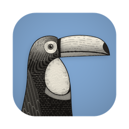
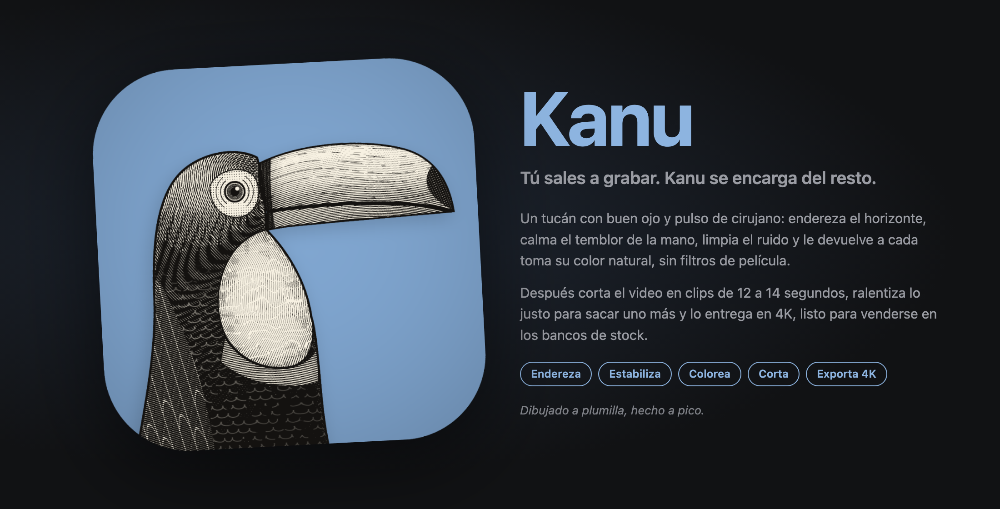
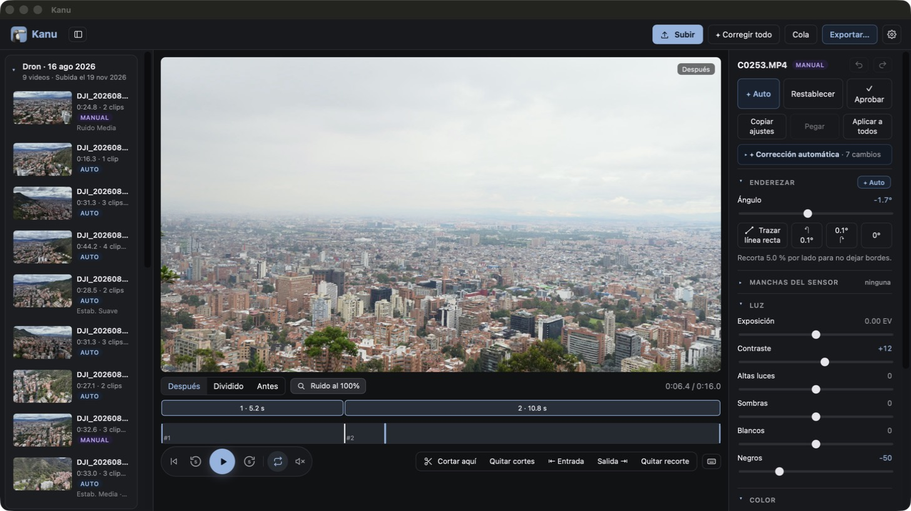
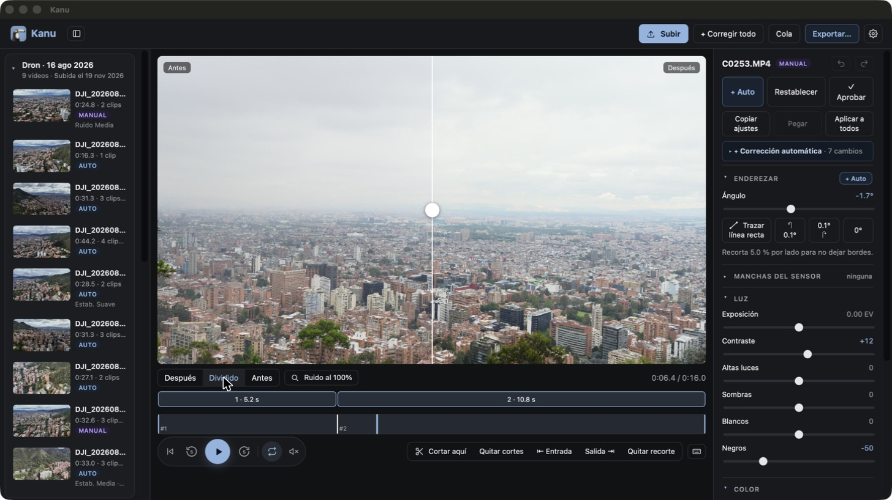
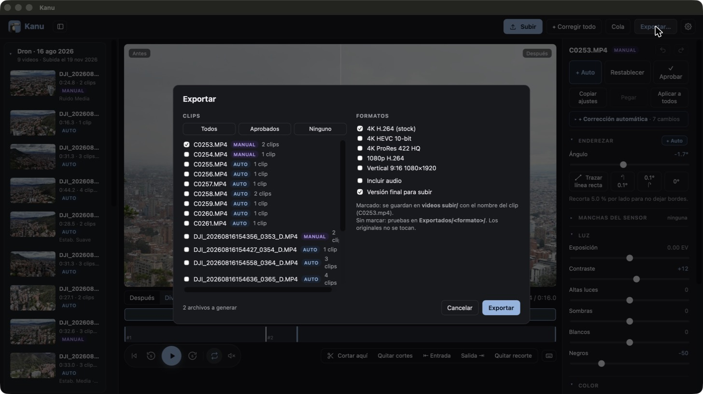

<h1 align="center">Kanu - Editor de Video Stock</h1>

<p align="center">
  
</p>

<p align="center">
  <a href="https://github.com/JhamG9/kanu-video-editor/releases/download/v0.3.0/Kanu-0.3.0.dmg"><b>⬇ Descargar Kanu 0.3.0 para Mac</b></a>
  (Apple Silicon, 109 MB) · <a href="#instalar">Cómo instalar</a>
</p>

<p align="center">
  
</p>

Kanu es un editor de video para Mac, hecho para preparar clips para bancos de video de stock.
Tú pones los videos de la cámara o del dron y Kanu los deja listos para subir:

- **Color automático y natural**: corrige exposición, balance de blancos y contraste, recupera el cielo
  quemado (superblancos de Sony) y puede aprender tu propio estilo a partir de pares antes/después.
- **Quita el ruido** de las tomas oscuras.
- **Estabiliza** con Gyroflow: usa el giroscopio de la cámara (Sony) o analiza la imagen (dron, celular)
  y elige solo el nivel para que la toma parezca de trípode.
- **Endereza** el horizonte y la perspectiva, de forma automática o trazando una línea recta.
- **Limpia las manchas del sensor** (polvo) sin inventar píxeles.
- **Corta en clips de 12 a 14 s**, ralentizando lo mínimo para sacar un clip más, sin inventar fotogramas.
- **Exporta en 4K H.264** sin audio, listo para subir a la carpeta `videos subir/`.

Se puede trabajar clip por clip en el editor, con vista antes/después, o procesar una tanda entera de una vez.
La guía de uso paso a paso está en [LEEME.md](LEEME.md).

## La interfaz

**El editor.** A la izquierda los clips de la tanda, al centro el visor con los cortes y a la derecha los ajustes.



**Antes y después.** La vista *Dividido* compara el original con la corrección sobre el mismo fotograma.



**Subir una tanda.** Arrastra los videos, marca las opciones de la tanda y deja una nota si hace falta.
Kanu corrige y exporta todo solo.


**Exportar.** Elige los clips y los formatos. La versión final para stock va a `videos subir/`.



## Instalar

Necesitas un Mac con Apple Silicon (M1 o más nuevo) y macOS 12 o más reciente.

1. Descarga **[Kanu-0.3.0.dmg](https://github.com/JhamG9/kanu-video-editor/releases/download/v0.3.0/Kanu-0.3.0.dmg)**
   y ábrelo. Las versiones anteriores y las notas de cada una están en
   [Releases](https://github.com/JhamG9/kanu-video-editor/releases).
2. Arrastra **Kanu** a **Aplicaciones**.
3. La primera vez, macOS dirá que la app es de un desarrollador no identificado (no está firmada con una
   cuenta de Apple). Haz clic derecho en Kanu → **Abrir** → **Abrir**. Solo hace falta una vez.
4. Instala [Gyroflow](https://gyroflow.xyz/download) (gratis) en Aplicaciones para poder estabilizar.
   Si falta, Kanu te avisa; todo lo demás funciona sin él.

No hace falta instalar nada más: Kanu trae dentro Python, ffmpeg y todo lo necesario.
Tus videos, ajustes y exportados se guardan en **~/Movies/Kanu** (menú *Archivo → Mostrar carpeta de Kanu*).
Si algo falla al arrancar, el detalle queda en `~/Library/Logs/Kanu.log`.

### Desde el código (para desarrollar)

Requisitos: [Homebrew](https://brew.sh), Python 3.11 o más nuevo, ffmpeg y Gyroflow.

```bash
brew install python ffmpeg
```

```bash
git clone https://github.com/JhamG9/kanu-video-editor.git Kanu
```

Abre **Kanu.app** desde la carpeta `Kanu`. La primera vez tarda uno o dos minutos: crea el entorno de Python
e instala lo necesario. En este modo Kanu.app tiene que quedarse dentro del repositorio, y los videos y todo
lo que genera Kanu (`Videos/`, `videos subir/`, `Exportados/`, `ajustes/`, `estilo/`, `tandas/`, `.cache/`)
se guardan en la propia carpeta, sin ir al repositorio.

### Crear el instalador

```bash
tools/app/empaquetar.sh
```

Deja `Kanu-<versión>.dmg` en la raíz del proyecto. La primera vez descarga un Python portátil
([python-build-standalone](https://github.com/astral-sh/python-build-standalone), con su suma SHA-256 comprobada)
y ffmpeg para Apple Silicon ([Martin Riedl](https://ffmpeg.martin-riedl.de)) en `build/`. El `.dmg` pesa más
de 100 MB, así que no va al repositorio: súbelo como archivo de una *Release* en GitHub.

## Cómo está hecho

Kanu.app es una ventana nativa (Swift + WebKit) que arranca un motor local en Python (FastAPI) y muestra
el editor web en `http://localhost:8765`. Al cerrar la ventana se apaga el motor.

```
Kanu.app/           la app para abrir (ventana nativa compilada desde tools/app/)
backend/            motor en Python (FastAPI)
  kanu/config.py    rutas de datos y programas (KANU_DATA, KANU_FFMPEG, KANU_GYROFLOW…)
  kanu/core/        algoritmos puros: color (grade), análisis, cortes, manchas, estilo
  kanu/infra/       ffmpeg y Gyroflow
  kanu/services/    biblioteca de clips, vistas previas, exportación, tandas
  kanu/api/         FastAPI: app + routes por dominio
  kanu/cli.py       uso desde terminal (python -m kanu.cli stock)
  tests/            pytest (usan una carpeta de datos temporal)
apps/legacy-ui/     interfaz (HTML + JS), servida por el backend
tools/app/          código de Kanu.app (Swift), build.sh y empaquetar.sh (instalador .dmg)
tools/icono/        generador del icono (tucán)
```

## Desarrollo

```bash
cd backend
python3 -m venv .venv && .venv/bin/pip install -e ".[dev]"
.venv/bin/python -m kanu            # http://localhost:8765  (API en /docs)
.venv/bin/python -m pytest -q       # tests
.venv/bin/ruff check kanu           # linter
```

Si cambias `tools/app/Kanu.swift`, recompila la app con `tools/app/build.sh` (hace falta Xcode o sus
Command Line Tools).

Próximas fases: `apps/ui` (React + TypeScript + Vite) y `apps/desktop` (Electron, arranca el backend).

## Contribuir

Kanu es de código abierto y las mejoras son bienvenidas. Haz un fork, crea una rama y abre un pull request;
el dueño del repositorio lo revisa y lo aprueba. Los detalles están en [CONTRIBUTING.md](CONTRIBUTING.md).

## Licencia

[MIT](LICENSE): puedes usar, modificar y compartir Kanu libremente, manteniendo el aviso de autoría.
El instalador incluye ffmpeg, que se distribuye con su propia licencia (GPL v3).
