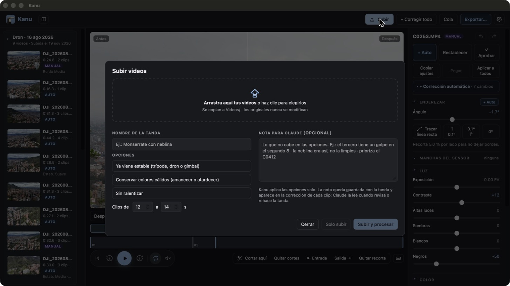

<p align="center">
  
</p>

<h1 align="center">Kanu - Editor de Video de Stock</h1>

<p align="center">
  
</p>

Kanu es un editor de video para Mac, hecho para preparar clips para bancos de video de stock.
Tú pones los videos de la cámara o del dron y Kanu los deja listos para subir:

- **Color automático y natural**: corrige exposición, balance de blancos y contraste, recupera el cielo
  quemado (superblancos de Sony) y puede aprender tu propio estilo a partir de pares antes/después.
- **Quita el ruido** de las tomas oscuras.
- **Estabiliza** con Gyroflow: usa el giroscopio de la cámara (Sony) o analiza la imagen (dron, celular)
  y elige solo el nivel para que la toma parezca de trípode.
- **Endereza** el horizonte y la perspectiva, de forma automática o trazando una línea recta.
- **Limpia las manchas del sensor** (polvo) sin inventar píxeles.
- **Corta en clips de 12 a 14 s**, ralentizando lo mínimo para sacar un clip más, sin inventar fotogramas.
- **Exporta en 4K H.264** sin audio, listo para subir a la carpeta `videos subir/`.

Se puede trabajar clip por clip en el editor, con vista antes/después, o procesar una tanda entera de una vez.
La guía de uso paso a paso está en [LEEME.md](LEEME.md).

## La interfaz

**Antes y después.** La vista *Dividido* compara el original con la corrección sobre el mismo fotograma.


**Subir una tanda.** Arrastra los videos, marca las opciones de la tanda y deja una nota si hace falta.
Kanu corrige y exporta todo solo.



**Exportar.** Elige los clips y los formatos. La versión final para stock va a `videos subir/`.


## Instalar

Requisitos: un Mac con Apple Silicon (macOS 12 o más nuevo), [Homebrew](https://brew.sh),
Python 3.11 o más nuevo, ffmpeg y [Gyroflow](https://gyroflow.xyz) (gratis) en Aplicaciones.

```bash
brew install python ffmpeg
```

```bash
git clone <url-de-este-repositorio> Kanu
```

Luego abre **Kanu.app** desde la carpeta `Kanu` (puedes arrastrarlo al Dock).
La primera vez tarda uno o dos minutos: crea el entorno de Python e instala lo necesario.
Después abre en unos segundos.

- Kanu.app tiene que quedarse dentro de la carpeta del repositorio, porque ahí busca el motor y guarda los videos.
- Si descargaste el repositorio como .zip en lugar de clonarlo, macOS puede bloquear la app la primera vez.
  Haz clic derecho en Kanu.app → **Abrir** → **Abrir**.
- Si algo falla al arrancar, el detalle queda en `~/Library/Logs/Kanu.log`.

Los videos y todo lo que genera Kanu (`Videos/`, `videos subir/`, `Exportados/`, `ajustes/`, `estilo/`,
`tandas/`, `.cache/`) se quedan en tu Mac y no van al repositorio.

## Cómo está hecho

Kanu.app es una ventana nativa (Swift + WebKit) que arranca un motor local en Python (FastAPI) y muestra
el editor web en `http://localhost:8765`. Al cerrar la ventana se apaga el motor.

```
Kanu.app/           la app para abrir (ventana nativa compilada desde tools/app/)
backend/            motor en Python (FastAPI)
  kanu/config.py    rutas de datos y programas (KANU_DATA, KANU_FFMPEG, KANU_GYROFLOW…)
  kanu/core/        algoritmos puros: color (grade), análisis, cortes, manchas, estilo
  kanu/infra/       ffmpeg y Gyroflow
  kanu/services/    biblioteca de clips, vistas previas, exportación, tandas
  kanu/api/         FastAPI: app + routes por dominio
  kanu/cli.py       uso desde terminal (python -m kanu.cli stock)
  tests/            pytest (usan una carpeta de datos temporal)
apps/legacy-ui/     interfaz (HTML + JS), servida por el backend
tools/app/          código de Kanu.app (Swift) y build.sh para recompilarla
tools/icono/        generador del icono (tucán)
```

## Desarrollo

```bash
cd backend
python3 -m venv .venv && .venv/bin/pip install -e ".[dev]"
.venv/bin/python -m kanu            # http://localhost:8765  (API en /docs)
.venv/bin/python -m pytest -q       # tests
.venv/bin/ruff check kanu           # linter
```

Si cambias `tools/app/Kanu.swift`, recompila la app con `tools/app/build.sh` (hace falta Xcode o sus
Command Line Tools).

Próximas fases: `apps/ui` (React + TypeScript + Vite) y `apps/desktop` (Electron, arranca el backend).
